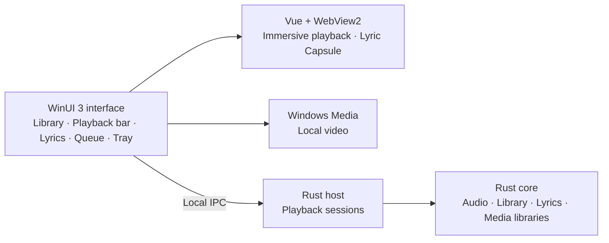

<div align="center">

<picture>
  <source media="(prefers-color-scheme: dark)" srcset="docs/images/hero-dark.webp">
  <source media="(prefers-color-scheme: light)" srcset="docs/images/hero-light.webp">
  
</picture>

<h3>Clean design, thoughtful features, and a pure local listening and viewing experience</h3>

<p><sub>Music can reach across the prejudices between us, across time and space, to carry what its creators want to say.</sub></p>

[](https://github.com/Oakflat/OFPlayerCommunity/actions/workflows/ci.yml)


[](LICENSE)
[](https://github.com/Oakflat/OFPlayerCommunity/stargazers)

[简体中文](README.md) · **English**

[New interface](#new-interface) · [Features](#features) · [Architecture](#architecture) · [Getting started](#getting-started) · [Data & privacy](#data--privacy) · [License](#license)

</div>

<br>

**OFPlayer Community** is the Windows desktop community edition of OFPlayer, with support for local music, local video and third-party media libraries. It succeeds the earlier Tauri-based Community edition. It pairs a **native WinUI interface** with a **Rust music core** and the **Windows Media video engine**, and builds on its own, with no private Hub services, accounts or licenses required.

## New interface

The interface has been rebuilt for this generation of Community. The library, playback bar, lyrics, queue and tray now share the interface and interactions of the main OFPlayer WinUI client, replacing the separate minimal song list.

<table>
  <tr>
    <td width="50%" valign="top">
      <b>Native sidebar</b><br>
      <sub>Expanded and compact layouts (224/48 DIP) with frame-by-frame width transitions, animated music icons and smart playlist groups. Scroll position, focus and selection survive refreshes.</sub>
    </td>
    <td width="50%" valign="top">
      <b>Main playback bar</b><br>
      <sub>Previous/next, in order/repeat/shuffle, progress, volume, output device and track details, just like the main client.</sub>
    </td>
  </tr>
  <tr>
    <td width="50%" valign="top">
      <b>Immersive playback</b><br>
      <sub>An album-art backdrop with synced lyrics. The page is built from the Vue sources in this repository's <code>web/</code> folder and runs in WebView2.</sub>
    </td>
    <td width="50%" valign="top">
      <b>Desktop Lyric Capsule</b><br>
      <sub>Lyrics that float on your desktop, with appearance options in Settings.</sub>
    </td>
  </tr>
  <tr>
    <td width="50%" valign="top">
      <b>Light and dark</b><br>
      <sub>Light and dark themes, with the current album art available as a backdrop.</sub>
    </td>
    <td width="50%" valign="top">
      <b>System tray</b><br>
      <sub>The main client's tray menu, minimize to tray and configurable close behavior.</sub>
    </td>
  </tr>
</table>

<div align="center">
<picture>
  <source media="(prefers-color-scheme: dark)" srcset="docs/images/video-dark.webp">
  <source media="(prefers-color-scheme: light)" srcset="docs/images/video-light.webp">
  
</picture>
<sub>Local video: external and embedded subtitles, playback speed, full screen, and resume where you left off</sub>
</div>

## Features

<table>
  <tr><th width="180" align="left">Area</th><th align="left">What's supported</th></tr>
  <tr><td><b>Local music</b></td><td>File and folder import, album and artist browsing, search and filters, playlists, favorites, play history, queue editing and reordering, synced lyrics, cover art and track details, output device selection</td></tr>
  <tr><td><b>Playback interface</b></td><td>Main playback bar, immersive playback, desktop Lyric Capsule, themes and album-art backdrops, tray and close-behavior settings</td></tr>
  <tr><td><b>Third-party libraries</b></td><td>User-configured WebDAV and Navidrome/Subsonic: connection management, browsing, and download-and-cache playback</td></tr>
  <tr><td><b>Local video</b></td><td>Local video playback, external and embedded subtitles, playback speed, full-screen immersive playback, automatic resume</td></tr>
</table>

> [!NOTE]
> Community focuses on local playback. It does not include:
> - Device pairing, OFPlayer streaming, handoff, Together or the official cloud library
> - Accounts, sign-in sync or license purchases
> - The official auto-update service or Store packaging and distribution

## Architecture



The native host owns music playback state. Video plays inside the WinUI process: switching to video releases the music output, and returning to music stops the video. When the app exits, it cleans up its own native child processes.

<details>
<summary><b>Repository layout</b></summary>
<br>

| Path | Responsibility |
| :--- | :--- |
| `crates/community-core` | Local audio, library, lyrics, import, third-party media libraries and legacy data migration |
| `crates/community-host` | Music playback sessions and local inter-process communication |
| `src-winui/OFPlayer.Community` | WinUI interface and system media controls |
| `src-winui/OFPlayer.Community.Presentation` | Presentation, protocol and interaction logic shared with the main player |
| `src-winui/OFPlayer.WindowsMedia` | Windows local video backend |
| `web` | Immersive playback and Lyric Capsule pages, built from source |
| `src-winui/*.Tests`, `tests` | Managed tests, protocol tests, native process contracts and dependency boundary tests |

</details>

## Getting started

> [!IMPORTANT]
> The 26.0.4 installer under Releases is the previous Tauri-based Community edition. The new WinUI Community edition currently has to be built from source.

### Requirements

Building requires **Windows**. Toolchain versions are pinned by `rust-toolchain.toml`, `global.json` and the project files in this repository.

| Tool | Used for |
| :--- | :--- |
| PowerShell 7 | Running the build script |
| Rustup | The Rust toolchain for the music core and host |
| .NET SDK | Building the WinUI client |
| Node.js and npm | Building the immersive page and Lyric Capsule |
| Visual Studio Build Tools | C++ x64 build tools and the Windows SDK |

### Build and run

Open PowerShell 7 at the repository root to build the embedded pages, the Rust core and the WinUI client from source:

```powershell
git clone https://github.com/Oakflat/OFPlayerCommunity.git
cd OFPlayerCommunity
./scripts/build.ps1 -Configuration Release
```

When the build finishes, run:

```text
.artifacts/dotnet/OFPlayer.Community/bin/x64/Release/net10.0-windows10.0.26100.0/win-x64/OFPlayer.Community.exe
```

Test commands are in the [development guide](docs/development.md), and what the interface keeps and leaves out is described in [interface and feature scope](docs/frontend-parity.md). Both documents are in Chinese. This repository does not include internal signing, Store submission or distribution packaging scripts.

## Data & privacy

- **Stored locally**: Your library, playlists, favorites, play history, lyrics, subtitles and media files stay in `%LOCALAPPDATA%/ofplayer-community`.
- **Migrating from the old version**: On first launch, if the new folder doesn't exist yet, Community can bring over your local library, playlists, favorites, history, playback positions and cover art from the old `%LOCALAPPDATA%/ofplayer`. The original database and media files are left in place, existing Community data is never overwritten, and accounts, licenses, pairings and remote connection credentials are not migrated. Quit the old Tauri client before migrating.
- **Third-party libraries**: WebDAV and Navidrome/Subsonic connection details are stored only on your computer, and requests go straight to the server you choose, never through OFPlayer cloud services.
- **Activity statistics**: Community includes a required, minimal daily activity count, with no option to turn it off in the diagnostics page. It contains no track titles, file paths, media content, account or hardware identifiers, and local playback is unaffected when you're offline.

See the [privacy notice](docs/privacy.md) (in Chinese) for details.

## Acknowledgements

First of all, thank you to everyone who has quietly followed this project and shared encouraging feedback. Your support is what keeps me moving it forward.

I've always believed that good music can change a person profoundly, and that the way it reaches us matters just as much. That's why I made OFPlayer. I hope music can reach past prejudice, time and space to carry what its creators want to say. Through OFPlayer, I also want to share my own belief: **a clean, beautiful UI and carefully considered features, bringing a pure experience to the community.** That's why most of our code will stay under open-source licenses for the long term.

## Star History

<div align="center">
<picture>
  <source media="(prefers-color-scheme: dark)" srcset="https://api.star-history.com/svg?repos=oakflat/ofplayercommunity&type=Date&theme=dark">
  <source media="(prefers-color-scheme: light)" srcset="https://api.star-history.com/svg?repos=oakflat/ofplayercommunity&type=Date">
  
</picture>
<sub>Data from <a href="https://www.star-history.com/#Oakflat/OFPlayerCommunity&amp;Date">star-history.com</a></sub>
</div>

## License

| Component | License |
| :--- | :--- |
| WinUI client, tests, docs and build configuration | [MIT](LICENSE-MIT) |
| Rust core and host (`crates/`) | [Apache-2.0](LICENSE-APACHE) |
| Third-party sources | Their own bundled licenses |

See [LICENSE](LICENSE) for details.

<br>

<div align="center">
<sub>Thanks to everyone who listens · <a href="#top">Back to top</a></sub>
</div>
