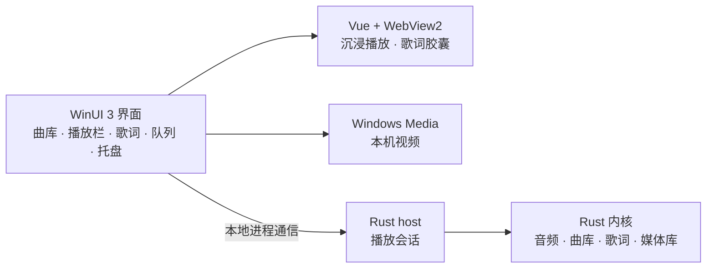

<div id="top" align="center">

<picture>
  <source media="(prefers-color-scheme: dark)" srcset="docs/images/hero-dark.webp">
  <source media="(prefers-color-scheme: light)" srcset="docs/images/hero-light.webp">
  
</picture>

<h3>干净漂亮的界面，深思熟虑的功能，纯粹的本地视听体验</h3>

<p><sub>音乐能跨越我们与彼此之间的偏见，跨越时间与空间，传达作者的想法。</sub></p>

[](https://github.com/Oakflat/OFPlayerCommunity/actions/workflows/ci.yml)


[](LICENSE)
[](https://github.com/Oakflat/OFPlayerCommunity/stargazers)

**简体中文** · [English](README.en.md)

[全新界面](#全新界面) · [功能](#功能) · [架构](#架构) · [快速开始](#快速开始) · [数据与隐私](#数据与隐私) · [许可](#许可)

</div>

<br>

**OFPlayer Community** 是用于 Windows 的开源音乐与视频播放器，接替早期 Tauri 社区版。可以直接导入本机文件，也可以连接自己的 WebDAV 或 Navidrome 曲库。使用这些功能无需 OFPlayer 商业账号。[数据与隐私](docs/privacy.md)

要体验新版 WinUI 界面，请按下方[快速开始](#快速开始)从源码构建。Releases 中的 26.0.4 安装包对应旧 Tauri 版。

## 全新界面

这一代社区版的界面已整体重做：曲库、播放栏、歌词、队列和托盘直接沿用主线 WinUI 的界面与交互，不再是另写的极简歌曲列表。

<table>
  <tr>
    <td width="50%" valign="top">
      <b>原生侧栏</b><br>
      <sub>224/48 DIP 双态布局与逐帧宽度过渡，动态音乐图标和智能歌单分组，刷新时保留滚动、焦点与选中状态。</sub>
    </td>
    <td width="50%" valign="top">
      <b>主线播放栏</b><br>
      <sub>上一首/下一首、顺序/循环/随机、进度、音量、输出设备与歌曲详情，和主线客户端一致。</sub>
    </td>
  </tr>
  <tr>
    <td width="50%" valign="top">
      <b>沉浸播放</b><br>
      <sub>封面背景与定时歌词，页面由本仓 <code>web/</code> 的 Vue 源码构建，运行在 WebView2 中。</sub>
    </td>
    <td width="50%" valign="top">
      <b>桌面歌词胶囊</b><br>
      <sub>悬浮在桌面上的歌词，外观可在设置中调整。</sub>
    </td>
  </tr>
  <tr>
    <td width="50%" valign="top">
      <b>浅色 / 深色</b><br>
      <sub>浅色与深色主题，正在播放的封面可作为背景。</sub>
    </td>
    <td width="50%" valign="top">
      <b>托盘常驻</b><br>
      <sub>主线托盘菜单、最小化到托盘与关闭行为设置。</sub>
    </td>
  </tr>
</table>

<div align="center">
<picture>
  <source media="(prefers-color-scheme: dark)" srcset="docs/images/video-dark.webp">
  <source media="(prefers-color-scheme: light)" srcset="docs/images/video-light.webp">
  
</picture>
<sub>本机视频：外挂/内嵌字幕、倍速、全屏与播放进度记忆</sub>
</div>

## 功能

<table>
  <tr><th width="140" align="left">模块</th><th align="left">支持能力</th></tr>
  <tr><td><b>本机音乐</b></td><td>文件与目录导入、专辑/歌手浏览、搜索筛选、歌单、收藏、播放历史、队列编辑与排序、定时歌词、封面与歌曲详情、输出设备选择</td></tr>
  <tr><td><b>播放界面</b></td><td>主线播放栏、沉浸播放、桌面歌词胶囊、主题与封面背景、托盘和关闭行为设置</td></tr>
  <tr><td><b>第三方媒体库</b></td><td>用户配置的 WebDAV、Navidrome/Subsonic；连接管理、浏览及下载缓存播放</td></tr>
  <tr><td><b>本机视频</b></td><td>本地视频文件播放、外挂/内嵌字幕加载、倍速调节、全屏沉浸播放、播放进度自动恢复</td></tr>
</table>

> [!NOTE]
> 社区版专注本机播放，以下能力不在其中：
> - 设备配对、OFPlayer 串流、handoff、Together 和官方云曲库
> - 账号系统、登录同步及许可证购买流程
> - 官方自动更新服务与商店专用打包分发流程

## 架构



音乐播放状态由原生 host 统一维护。视频在 WinUI 进程内播放：切换到视频时释放音乐输出，返回音乐时停止视频。应用退出后回收自己的原生子进程。

<details>
<summary><b>仓库结构</b></summary>
<br>

| 路径 | 职责 |
| :--- | :--- |
| `crates/community-core` | 本地音频、曲库、歌词、导入、第三方媒体库与旧数据迁移 |
| `crates/community-host` | 音乐播放会话和本地进程通信 |
| `src-winui/OFPlayer.Community` | WinUI 界面和系统媒体控制 |
| `src-winui/OFPlayer.Community.Presentation` | 主线播放器的纯展示、协议与交互逻辑 |
| `src-winui/OFPlayer.WindowsMedia` | Windows 本地视频后端 |
| `web` | 从源码构建的沉浸播放和歌词胶囊页面 |
| `src-winui/*.Tests`、`tests` | 托管测试、协议测试、原生进程契约与依赖边界测试 |

</details>

## 快速开始

> [!IMPORTANT]
> Releases 中的 26.0.4 安装包是旧版 Tauri 社区版。全新的 WinUI 社区版目前需要从源码构建。

### 环境要求

构建需要 **Windows**，工具链版本由仓库中的 `rust-toolchain.toml`、`global.json` 和项目工程文件固定。

| 工具 | 用途 |
| :--- | :--- |
| PowerShell 7 | 运行构建脚本 |
| Rustup | Rust 工具链，构建音乐内核与 host |
| .NET SDK | 构建 WinUI 客户端 |
| Node.js 与 npm | 构建沉浸页和歌词胶囊 |
| Visual Studio Build Tools | C++ x64 编译工具与 Windows SDK |

### 编译与运行

在仓库根目录打开 PowerShell 7，从当前源码依次构建嵌入页面、Rust 内核与 WinUI 客户端：

```powershell
git clone https://github.com/Oakflat/OFPlayerCommunity.git
cd OFPlayerCommunity
./scripts/build.ps1 -Configuration Release
```

构建完成后运行：

```text
.artifacts/dotnet/OFPlayer.Community/bin/x64/Release/net10.0-windows10.0.26100.0/win-x64/OFPlayer.Community.exe
```

测试命令见 [开发说明](docs/development.md)，界面保留与排除的范围见 [界面与功能边界](docs/frontend-parity.md)。本仓不包含内部签名、商店提交或分发打包脚本。

## 数据与隐私

- **本机保存**：曲库、歌单、收藏、播放历史、歌词、字幕和媒体文件都保存在 `%LOCALAPPDATA%/ofplayer-community`。
- **旧版迁移**：首次启动时，若新目录不存在，可以从旧 `%LOCALAPPDATA%/ofplayer` 迁入本地曲库、歌单、收藏、历史、位置及封面。原数据库和媒体文件保留，已有 Community 数据不会被覆盖，账号、许可证、配对和远程连接凭据不会迁入。迁移前请退出旧 Tauri 客户端。
- **第三方媒体库**：WebDAV、Navidrome/Subsonic 的连接信息只保存在本机，请求直接发往你指定的服务器，不经过 OFPlayer 云服务。
- **活跃统计**：Community 包含必需的最小每日活跃统计，没有诊断页开关。统计不包含曲名、路径、媒体内容、账号或硬件标识，网络不可用不影响本地播放。

详见 [隐私说明](docs/privacy.md)。

## 致谢与初心

首先，感谢所有默默关注以及提供正反馈的朋友。正是因为大家的支持，才让我有持续推进这个项目的动力。

我一直认为，好的音乐能够极大地改变一个人，而好的载体同样重要。这也是制作 OFPlayer 的初衷——我希望音乐能跨越偏见、时间与空间，去传达创作者的想法；同时，我也希望通过 OFPlayer 传达自己的理念：**以干净漂亮的 UI 和深思熟虑的功能，为社区带来纯粹的体验。** 因此，我们的大部分代码将长期保持开源许可。

## Star 趋势

<div align="center">
<picture>
  <source media="(prefers-color-scheme: dark)" srcset="https://api.star-history.com/svg?repos=oakflat/ofplayercommunity&type=Date&theme=dark">
  <source media="(prefers-color-scheme: light)" srcset="https://api.star-history.com/svg?repos=oakflat/ofplayercommunity&type=Date">
  
</picture>
<sub>数据来自 <a href="https://www.star-history.com/#Oakflat/OFPlayerCommunity&amp;Date">star-history.com</a></sub>
</div>

## 许可

| 组件 | 许可 |
| :--- | :--- |
| WinUI 客户端、测试、文档与构建配置 | [MIT](LICENSE-MIT) |
| Rust 内核与 host（`crates/`） | [Apache-2.0](LICENSE-APACHE) |
| 第三方源码 | 各自附带的许可 |

详见 [LICENSE](LICENSE)。

<br>

<div align="center">
<sub>感谢每一位聆听者 · <a href="#top">回到顶部</a></sub>
</div>
